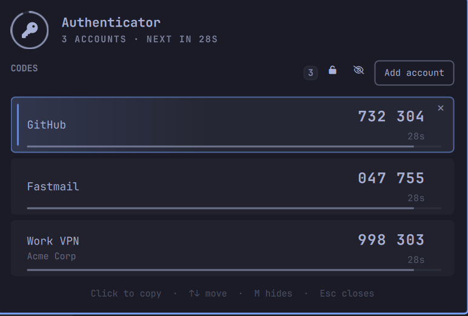

# Authenticator — TOTP codes in the Omarchy bar



A bar widget that generates your two-factor codes locally (RFC 6238 TOTP) and
puts them one click from the bar: click the key, read the code, click it to copy.
No phone, no cloud, no network.

```
  ⚿   ← bar widget            ┌───────────────────────────────────────────┐
                              │  Authenticator                            │
                              │  3 ACCOUNTS · LOGIN KEYRING               │
                              │  CODES                        ⛭  + Add    │
                              │  ┌─────────────────────────────────────┐  │
                              │  │ GitHub                    123 456 ✕ │  │
                              │  │ ▇▇▇▇▇▇▇▇▇▇▇▇▇▇▇▇▇▇▇▇              │  │
                              │  └─────────────────────────────────────┘  │
                              │  Click to copy · M hides · Esc closes     │
                              └───────────────────────────────────────────┘
```

## Install

Local folder (already the case if you built it here):

```bash
omarchy plugin enable psamoluk.totp --section right
omarchy restart shell
```

From the repository:

```bash
omarchy plugin add https://github.com/paulsamoluk/omarchy-authenticator --enable --yes
```

## Add an account

**From the panel** — click the key, then `Add account`, and paste either form:

- the `otpauth://` URI that sits next to a service's QR code:

  ```
  otpauth://totp/GitHub:you@example.com?secret=JBSWY3DPEHPK3PXP&issuer=GitHub&period=30&digits=6
  ```

- or, when the setup page only prints the key in text, the **bare base32 secret**
  plus a name for the account (`JBSWY3DPEHPK3PXP`). Spaces and lower case are
  fine. Bare secrets are added with the defaults services use: 6 digits,
  30-second period, SHA-1.

The panel sends the credential to the helper over **stdin**, so the secret never
appears in a process argument list.

### From a QR screenshot

Services hand out the same `otpauth://` URI as the QR code, so the QR can be the
input: copy the screenshot, open `Add account`, and press the **⧉ button** in
that card — the helper pipes the clipboard image through `zbarimg`, reads the
URI out of the QR and adds the account. A screenshot of a whole page works too
(the QR does not have to be cropped to size).

Pasting the **path** of an image (`~/Pictures/qr.png`, `.png/.jpg/.webp`) into
the field and pressing Add does the same thing. Either way the temporary copy of
the image is deleted straight after decoding — it contains the secret.

From the shell:

```bash
otp add-qr ~/Pictures/screenshot.png   # a file
otp add-qr --clipboard                 # whatever image is on the clipboard
```

**From the shell**, same thing:

```bash
OTP=~/.config/omarchy/plugins/psamoluk.totp/bin/otp

$OTP add-qr ~/Pictures/screenshot.png            # decode a QR screenshot
printf 'otpauth://totp/...' | $OTP add-uri        # URI on stdin
printf 'JBSWY3DPEHPK3PXP\n' | $OTP add --label GitHub --issuer GitHub   # bare secret
$OTP list
$OTP copy GitHub                                  # copies the current code
$OTP remove GitHub
```

Secrets, master passwords and `otpauth://` URIs are only ever read from
**stdin**: `--secret` and a URI on argv are refused outright, because another
local user can read a process's arguments out of `/proc` while it lives and
replay a live code.

`--digits`, `--period` and `--algorithm` (SHA1/SHA256/SHA512) are accepted on
`add`, and are read from the URI when using `add-uri`.

Optionally put the helper on `PATH`:
`ln -s ~/.config/omarchy/plugins/psamoluk.totp/bin/otp ~/.local/bin/otp`

## What it looks like

The bar shows a key, the same size and weight as its neighbours — no countdown
in the bar, nothing to misread at a glance. The panel drops out of the bar
**directly under that icon** and opens on a ring around the key carrying the
soonest code's countdown, then one card per account: label and issuer on the
left, the code in large type on the right, and a fuse along each card's bottom
edge that burns down as the code expires.

Colour is used for exactly two states, so a glance is enough:

- **accent** — this code changes in five seconds or less (ring, fuse and the
  seconds count turn accent), or you just copied it (card outline, check glyph,
  code tint for ~1.4 s).
- everything else stays in the theme's foreground at varying opacity.

Hovering a card lifts it and reveals its remove button; the selected card (the
one `↑`/`↓` and `Enter` act on) gets a wash from its accent edge. Codes fade in
as they roll, and the whole countdown moves five times a second instead of
stepping once per second.

## Master password

Optional, off by default. Set it in the panel — the padlock button in the
toolbar — and every secret moves into an **encrypted vault**
(`vault.gpg`, AES-256, GPG symmetric, passphrase never in argv) and out of the
login keyring. From then on:

- The password is asked **once per login**; unlocking opens a session key in
  `$XDG_RUNTIME_DIR/psamoluk.totp/session` (mode 0600, tmpfs, gone on logout) so
  the helper keeps working without asking again.
- It **re-locks after 15 minutes without use** (`lockMinutes` on the widget's
  `shell.json` entry changes that), and **Lock now** drops the session key
  immediately. While locked the helper refuses to produce a code at all.
- **There is no recovery.** The secrets are encrypted with that password, so
  forgetting it means there is nothing to decrypt: the only way forward is
  **Reset**, which deletes the vault and every account in it. Deleting files by
  hand gains nothing either — the vault stays unreadable and the keyring copy is
  gone.
- Removing the password (padlock card → Remove) unwraps the vault back into the
  login keyring, which needs the open session, not a re-typed password.
- An install from before the vault existed upgrades itself: the first unlock
  with the old password verifies it, writes the vault and clears the keyring
  copy in one step, keeping the same password and the same codes.

## Where the secrets live

- **Encrypted vault** once a master password is set: `~/.local/share/psamoluk.totp/vault.gpg`,
  AES-256 via GPG symmetric, one blob for every secret.
- **Login keyring when no password is set** (`secret-tool`, service
  `psamoluk.totp`, one item per account, labelled `omarchy-totp: <account>`).
  The item is cleared when you remove the account.
- `~/.local/share/psamoluk.totp/accounts.json` holds **metadata only** — labels,
  issuer, digits, period, algorithm — `0600`, no secrets, no codes.
- If no keyring backend answers (locked keyring, no D-Bus, no `secret-tool`), the
  helper falls back to storing the secret in that same `0600` file and says so in
  its output (`store: file`). Nothing is ever written world-readable.
- Codes are computed on demand and never stored or logged.
- Nothing here talks to the network, and nothing runs as root.

## Keyboard

| key | action |
|---|---|
| `↑` `↓` | move between codes |
| `Enter` | copy the selected code |
| `M` | hide/reveal codes (persisted) |
| `A` | focus the add field |
| `Esc` | close |

Clicking a row copies it: the code goes to the clipboard and is cleared again
after 60 s — but only if the clipboard still holds that code, so something you
copied later is left alone. Set `TOTP_CLIPBOARD_CLEAR` to change the delay.

The countdown to that clear runs in a small detached helper that receives the
expected value **on stdin**; it exists only in that process's memory, never in
its argument list, so the live code cannot be read out of `/proc` by another
local user. `tests/no-argv-leak.sh` asserts exactly that: it scans every
process's command line for the copied code for the whole timeout, and fails if
it finds one.

## Widget settings

Stored inline on the widget's `shell.json` entry:

- `maskCodes` — start with codes hidden (toggle with `M` in the panel).
- `showCountdown` — show the seconds left in the bar next to the key.

## Requirements

- `python3` (stdlib only), `secret-tool` (libsecret) for the keyring path,
  `wl-copy`/`wl-paste` (wl-clipboard) for copy, `zbarimg` (`zbar`) for reading a
  QR screenshot. All are optional except python3: without `secret-tool` secrets
  go to the `0600` file; without `wl-copy` the helper prints the code instead of
  copying it; without `zbar` the QR button explains what to install.
- No services, no sudo, no network, no build step.

## Security

Read this before trusting it with your second factor.

**Privilege boundary:** no sudo, no root, no system services, no network
requests, no post-install hooks, no background daemon. The plugin is QML loaded
inside the running `omarchy-shell`, plus one Python 3 (stdlib) helper that runs
only when the widget or the panel calls it.

**What it writes:** `~/.local/share/psamoluk.totp/` (dir 0700) holding
`accounts.json` (labels and TOTP parameters, 0600) and `vault.gpg` (secrets,
AES-256, 0600); the session key in `$XDG_RUNTIME_DIR/psamoluk.totp/session`
(0700 dir, 0600, tmpfs, removed on lock and at logout); login-keyring items when
no master password is set; and the clipboard, when you click a code. It never
writes to your Omarchy configuration.

**Secret handling:** every secret, password and URI reaches the helper on stdin —
`--secret` is rejected, codes are computed in memory and never written to disk,
and a decoded QR screenshot is deleted immediately after use. Codes are never
logged.

**What it protects against:** someone at your unlocked desktop reading your
codes, or lifting a copy of the store — with a master password set the secrets
are encrypted, and the panel refuses to generate codes while locked.

**What it does not protect against:** an attacker who can already run code as
your user. They can read the session key while it is open, attach to the shell,
or read the keyring when no master password is set. There is no recovery path
for a forgotten master password: resetting destroys the accounts. Marketplace
listing is not a security review; this is a local convenience for a personal
machine, not a hardened secrets manager.

## Uninstall

```bash
omarchy plugin remove psamoluk.totp --yes
```

Secrets live outside the plugin folder, so they survive the removal on purpose.
To clear them too: remove each account first (`otp remove <label>`), or delete
the keyring items by hand (`secret-tool clear service psamoluk.totp account <id>`)
and `rm -rf ~/.local/share/psamoluk.totp`.

## Verification note

TOTP generation is checked against the RFC 6238 SHA-1, SHA-256 and SHA-512 test
vectors (`94287082`/`46119246`/`90693936` at T=59) before any release.

## License

MIT — see `LICENSE`.
